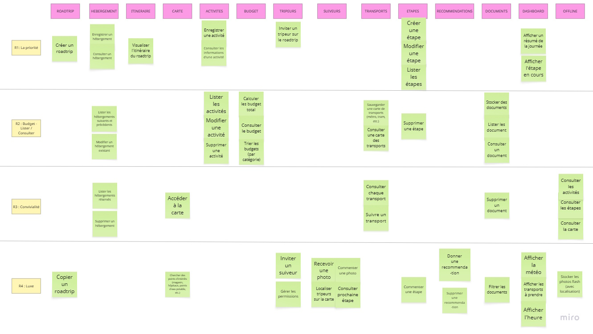
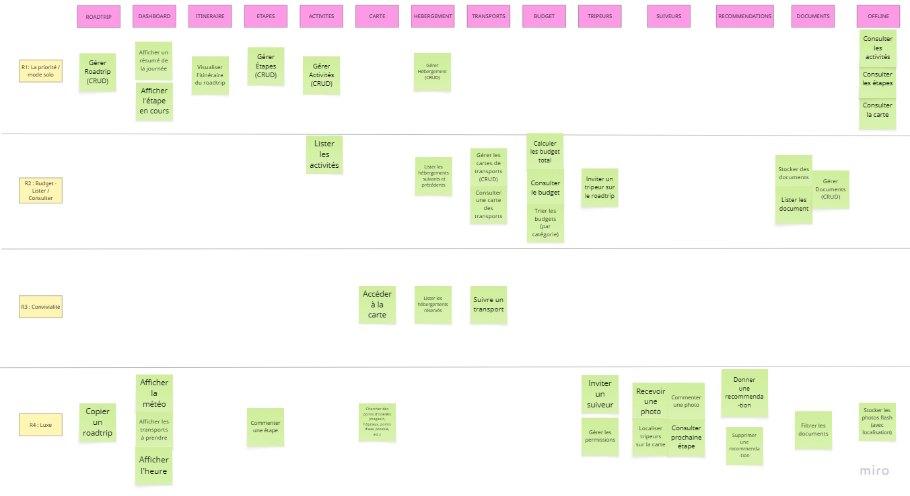

# Story Mapping

## Modèle effectué en groupe
Lors d'une séance de brainstorming, nous avons pu voir ensemble la confection d'un story mapping nous permettant de donner du sens au projet grâce à sa vue d'ensemble structurée et de découper le projet en fonctionnalités plus ou moins prioritaires.  
Sur notre représentation, nous avons décidé de placer les fonctionnalités les plus importantes sur la gauche du story mapping, et les moins importantes sur la droite. L'axe horizontal représente donc les priorités.  
L'axe vertical, lui, représente les priorités des fonctionnalités pour un même type de tâche. C'est-à-dire que pour une même catégorie de fonctionnalités comme l'hébergement, par exemple, enregistrer un hébergement ou consulter un hébergement est plus prioritaire que de lister les hébergements réservés, même si le tout reste prioritaire aux fonctionnalités offline.  
  

## Modèle modifié à l'aide de l'IA
L'IA nous a indiqué qu'il est plus propre de regrouper toutes les tâches liées à la gestion (créer, lire, modifier, supprimer) dans un post-it et d'indiquer "CRUD" pour signifier qu'il est bien question de gestion. C'est pourquoi, toutes les fonctionnalités de modification ou lecture qui étaient présentes dans R3, R4 ont été regroupées pour la majorité dans R1, et dans R2 pour les catégories moins prioritaires comme le transport ou les documents.  

